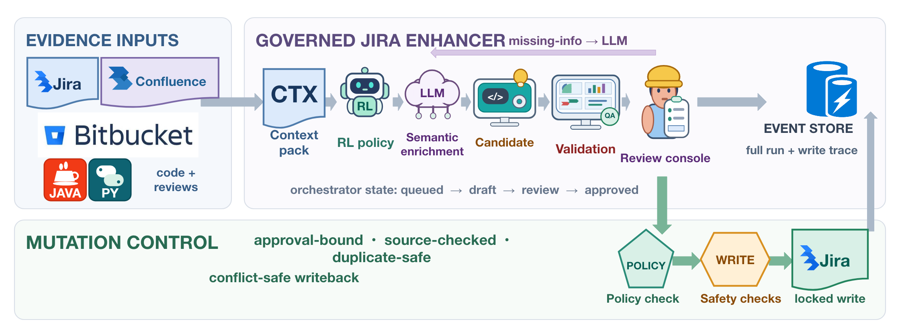

# Jira Enhancer

Jira Enhancer is a governance-aware workflow for turning incomplete Jira issues and epics into reviewable planning artifacts. It gathers linked evidence, scores readiness, selects a bounded prompt policy, produces a draft, and requires explicit human approval before writeback. The repository accompanies the TOSEM manuscript **“Jira Enhancer: A Governance-Aware Human–AI Collaboration System for Epic-to-Story Decomposition in Software Engineering.”**

This reviewer-facing artifact provides the implementation, tests, API contracts, manuscript source, publication figures, deterministic experiments, and public de-identified evidence.



## What is included

```text
.
├── src/jira_enhancer/              # application, connectors, governance, and RL policy code
├── tests/                          # unit, workflow, RL, and transaction-safety tests
├── openapi/                        # external, internal, and event contracts
├── patent/
│   ├── artifacts/tosem/            # de-identified and synthetic reviewer artifacts
│   ├── artifacts/b2_b3_pilot/      # aggregate pilot data and sanitized posterior trace
│   ├── generated/                  # manuscript figures and selected result tables
│   ├── images/                     # architecture and module figures
│   ├── reviewer_study/public_results/
│   ├── reproduce_public_figures.py
│   ├── generate_b2_b3_learning_figure.py
│   ├── run_rl_epoch_simulation.py
│   ├── run_source_bound_transaction_experiment.py
│   ├── verify_public_artifact.py
│   ├── jiraenhancer_tosem_acm.tex
│   └── jiraenhancer_tosem_acm.pdf
├── .env.example                    # placeholders only; never commit a real .env
├── Makefile
└── pyproject.toml
```

## Evidence and results

The paper combines several forms of evidence, each answering a distinct evaluation question.

| Evidence | Public input | Reproduction level | What it supports |
|---|---|---|---|
| Unit and workflow tests | Synthetic fixtures | Fully executable offline | Application behavior and workflow contracts |
| Source-bound transaction experiment | Fixed-seed synthetic fault schedule with 9 scenarios, 2,000 trials, and 4 control arrangements (72,000 observations) | Fully executable offline | Mutation safety under the declared injected faults |
| Authenticated Jira outcome summary | 70 de-identified successful-path endpoints (69 created issues and one safe duplicate) and a 45-item audit | Hash and statistic verification | Authenticated workflow feasibility, creation and duplicate-handling outcomes, parent linkage, and payload coverage |
| B3-only authenticated-output assessment | Access-controlled reviewer records; aggregate results in the manuscript | Aggregate result inspection | Assessment of B3's 69 full-text stories and 14 epic packages by two reviewers, with three masked repeats per reviewer |
| Matched blinded review | Aggregate de-identified result tables for 42 matched B1/B2/B3 packages, 14 inputs, and 210 stories | Paired weighted-score recalculation from public epic means | Five-reviewer assessment, with Reviewers 3--5 forming the primary comparison. The current weighted means are B3=4.32 and B2=3.59; the paired difference is +0.74 points (95% CI [0.55, 0.93], Holm-adjusted p=0.000244). B3 is higher on all 14 epics and has lower recorded assessment time |
| 5,000-unit B0–B3 analysis | Anonymized formula-expanded units | Released-row verification plus figure and statistic recomputation | Numerical sensitivity of the scoring formulas under seeded perturbations of reused inputs |
| SWE-bench Lite analysis | Public issue text | Executable after dataset download | Cross-dataset sensitivity of the scoring formulas on public issue descriptions |
| B2/B3 held-out learned-selection diagnostic | Three packets, aggregate scores, learned-state summary, and sanitized posterior trace | Aggregate inspection, posterior-trace validation, and figure reproduction | Six model-evaluator judgments comparing the complete one-pass B2 and learned-arm B3 configurations. B3 used up to three refinements and produced output that was 67% longer |

The matched-review composite gives implementation readiness 40%, dependencies and risks 20%, granularity and actionability 20%, and each of the four remaining rubric dimensions 5%. These weights were selected after the initial analysis; the revised weighted results use the current reviewer-corrected ratings. Reviewers 3--5 form the primary set because Reviewers 1--2 had earlier B3 exposure. The comparison averages ratings within each of the 14 matched epics. B2 and B3 used 14 and 173 model calls respectively, so the reported quality and review-time gains compare complete workflows with different computational budgets.

The public files provide the aggregate evidence used by the manuscript. Enterprise source text and operational metadata, together with corrected reviewer-level ratings and comments, remain access-controlled.

## Requirements

- Python 3.11 or newer
- A POSIX shell for the Makefile examples
- A LaTeX distribution with `latexmk` for rebuilding the manuscript
- Network access only for the optional SWE-bench Lite download or live connectors

The core application uses the Python standard library. Research and figure scripts use the `reviewer` dependency group.

## Five-minute reviewer check

Create an isolated environment and install the project:

```bash
python3 -m venv .venv
source .venv/bin/activate
python -m pip install --upgrade pip
python -m pip install -e '.[reviewer]'
```

Run the public artifact verification, the full test suite, the seeded fault
schedule, and public figure regeneration:

```bash
make reviewer-check
```

To run only the manuscript-sized fault schedule, use:

```bash
make fault-injection
```

The reviewer-check outputs are written below `outputs/reproduced/`. The optional public benchmark writes manuscript-ready tables and figures under `patent/generated/`, and `make paper` writes LaTeX build files under `patent/out_tosem/`. The public figure target also rebuilds the learned arm-selection curve from its sanitized posterior trace.

## Run the application with synthetic data

Mock mode processes bundled local fixtures and keeps its outputs in the local runtime store.

```bash
export CODEX_CONFIG_PATH="$(pwd)/reviewer_runtime/no-codex-config.toml"
export JIRA_ENHANCER_CONNECTOR_MODE=mock
export JIRA_ENHANCER_REASONING_MODE=heuristic
export JIRA_ENHANCER_USE_CODEX_EXEC=false
export JIRA_ENHANCER_RL_ENABLED=false

PYTHONPATH=src python -m jira_enhancer \
  --storage-root ./reviewer_runtime \
  run \
  --scope-type issue \
  --scope-value DEMO-18324 \
  --requestor reviewer@example.org
```

The global `--storage-root` option must appear before the subcommand. The JSON output contains a `runId`. Use that value in the following commands:

```bash
PYTHONPATH=src python -m jira_enhancer --storage-root ./reviewer_runtime \
  show-run --run-id RUN_ID

PYTHONPATH=src python -m jira_enhancer --storage-root ./reviewer_runtime \
  approve --run-id RUN_ID --issue-key DEMO-18324 \
  --decision approve --reviewer approver@example.org

PYTHONPATH=src python -m jira_enhancer --storage-root ./reviewer_runtime \
  writeback --run-id RUN_ID --issue-key DEMO-18324
```

In mock mode, writeback mutates an in-memory Jira copy for the current process. Run, approval, and writeback audit records persist below `--storage-root`, but a new invocation reloads the bundled fixture.

Start the local UI and API with:

```bash
PYTHONPATH=src python -m jira_enhancer \
  --storage-root ./reviewer_runtime serve --host 127.0.0.1 --port 8080
```

Open <http://127.0.0.1:8080/>. The UI can create a run, inspect candidates, record approval or rejection, request regeneration or user input, execute approved writeback, replay a run, and suggest or create approved stories from an epic. The prompt-learning view is available at <http://127.0.0.1:8080/ui/rl>.

## Workflow

The implementation keeps reasoning separate from mutation:

1. The scope resolver expands an issue, epic, sprint, or release.
2. The scanner reads issue fields and linked evidence.
3. The scorer records readiness, confidence, warnings, and policy flags.
4. When `JIRA_ENHANCER_RL_ENABLED=true`, the prompt service filters policy arms by governance predicates and selects an eligible arm. RL is disabled by default.
5. The reasoning layer creates or refines a candidate draft.
6. Candidate validation checks missing or placeholder acceptance and next-step fields, dependency/evidence alignment, and limited scope contradictions. Duplicate targets are canonicalized.
7. A reviewer records an explicit decision.
8. A source-bound causal envelope binds the source revision, draft, policy, reviewer decision, target set, and idempotency key.
9. Writeback separately checks the run and issue, approved draft, policy snapshot and target fields, source hash or revision, transaction identifier, and idempotency identifier. It proceeds only if the envelope still matches the current state.

The RL component adapts prompt selection within the validation, policy, approval, and transaction checks.

## API contracts

Selected HTTP contract documents are in [`openapi/`](openapi/). The implementation provides these principal endpoints:

- `POST /api/v1/runs`
- `GET /api/v1/runs/{runId}`
- `GET /api/v1/runs/{runId}/items/{issueKey}`
- `POST /api/v1/runs/{runId}/items/{issueKey}/approval`
- `POST /api/v1/runs/{runId}/approval`
- `POST /api/v1/runs/{runId}/items/{issueKey}/interaction-answer`
- `POST /api/v1/runs/{runId}/items/{issueKey}/writeback`
- `POST /api/v1/runs/{runId}/writeback`
- `POST /api/v1/replay/{runId}`
- `POST /api/v1/epics/{epicKey}/stories/suggest`
- `POST /api/v1/epics/{epicKey}/stories/create`

The approval contract accepts `approve`, `reject`, `regenerate`, `user_input`, and `prompt`. This allows a reviewer to give a suggestion or a new prompt before a candidate is approved.

## Reproduce the public evidence

### 1. Verify the de-identified Jira artifact

```bash
python patent/verify_public_artifact.py
```

The verifier checks SHA-256 hashes, row counts, wave counts, confidence statistics, creation outcomes, link checks, and audited payload coverage against `patent/artifacts/tosem/analysis_summary.json`.

Verification starts from the released de-identified rows; the enterprise export is a separate access-controlled step.

### 2. Run all application tests

```bash
PYTHONPATH=src python -m unittest discover -s tests -p 'test_*.py' -v
```

Run the transaction tests alone with:

```bash
PYTHONPATH=src python -m unittest tests.test_causal_transaction -v
```

### 3. Reproduce the source-bound transaction experiment

```bash
PYTHONPATH=src python patent/run_source_bound_transaction_experiment.py \
  --output-dir outputs/reproduced/source_bound_transaction \
  --trials-per-scenario 2000 \
  --seed 20260726
```

The experiment applies the same transaction payload and fault schedule to four control arrangements. It writes trial rows, summaries, paired comparisons, an SVG, a LaTeX table, metadata, and checksums. Its scenario-balanced rates describe outcomes under the declared injected faults.

### 4. Rebuild the public figures

```bash
make public-figures
```

This target reads released files under `patent/artifacts/`. It regenerates the de-identified confidence view, scoring-model comparison figures, arm-posterior curve, and critic-reward heatmap.

To rebuild only the learned-selection curve, use:

```bash
PYTHONPATH=src python patent/generate_b2_b3_learning_figure.py \
  --output outputs/reproduced/figures/b2_b3_arm_learning.png \
  --reward-output outputs/reproduced/figures/b2_b3_critic_reward_heatmap.png
```

Both figures are rebuilt from a sanitized 99-step posterior trace. They show posterior learning and model-critic rewards, using de-identified aggregate values.

The editable architecture source is `patent/images/system_architecture.drawio`. The four module diagrams and control-flow image are provided as publication-resolution PNG files.

### 5. Recalculate the weighted matched-review results

Public aggregate results are under:

```text
patent/reviewer_study/public_results/
```

The directory contains the current weighted method summaries, paired contrasts, dimension summaries, reliability diagnostics, and resource accounting. `matched_review_epic_scores.csv` provides paired weighted means under neutral unit identifiers. Recalculate the means, exact sign-flip tests, Holm adjustments, and 100,000-resample confidence intervals with:

```bash
python patent/reviewer_study/verify_weighted_results.py
```

The command reports both reviewer sets and both method contrasts. `RESULTS.md` explains the weights and the matched-epic calculations. Reviewer-level ratings, comments, and allocation keys remain access-controlled.

### 6. Run the optional SWE-bench Lite sensitivity diagnostic

Install the benchmark extras and run:

```bash
python -m pip install -e '.[reviewer,benchmark]'
python patent/run_public_benchmark_eval.py
python patent/generate_cross_dataset_comparison.py
```

The first run downloads `princeton-nlp/SWE-bench_Lite` from Hugging Face. This analysis sends public issue descriptions through the declared scoring formulas and reports their sensitivity across source texts.

## Build the manuscript

The repository includes the current LaTeX source, the `patent/references_2020_plus.bib` bibliography, and the tables and figures used by the manuscript.

```bash
cd patent
latexmk -pdf -interaction=nonstopmode -halt-on-error \
  -outdir=out_tosem jiraenhancer_tosem_acm.tex
```

The current reviewer copy is `patent/jiraenhancer_tosem_acm.pdf`.

## Optional live connectors

The optional live connectors use REST adapters for Jira, Confluence, and Bitbucket. They read configuration from exported environment variables. Use `.env.example` as a checklist and set the required values in the shell:

```bash
export JIRA_ENHANCER_CONNECTOR_MODE=live
export JIRA_BASE_URL=https://jira.example.com
export JIRA_USERNAME=user@example.com
export JIRA_TOKEN='replace-with-a-local-secret'
export JIRA_STORY_POINTS_FIELD=customfield_12344
export CONFLUENCE_BASE_URL=https://confluence.example.com
export CONFLUENCE_USERNAME=user@example.com
export CONFLUENCE_TOKEN='replace-with-a-local-secret'
export BITBUCKET_BASE_URL=https://bitbucket.example.com
export BITBUCKET_USERNAME=user@example.com
export BITBUCKET_TOKEN='replace-with-a-local-secret'
```

Keep `.env` and credentials in local, access-controlled storage. Start live writeback in a non-production project with restricted field mappings and a least-privilege service account.

The examples above use the deterministic local setting `JIRA_ENHANCER_REASONING_MODE=heuristic`. Model-backed reasoning uses a separately configured provider or local Codex environment.

## Reproduction paths

The application tests and transaction experiment run locally from synthetic fixtures. Released de-identified rows support verification of the Jira outcome summaries, and the sanitized posterior trace supports rebuilding the B2/B3 learning figures. Public matched-review tables support inspection of the human-study results; the corrected rating rows and enterprise source material remain restricted. The 5,000-unit and public issue-text analyses reproduce the numerical behavior of the scoring formulas. A fresh model-generation run also depends on the configured model service and its sampling behavior.

## Security and data-handling notes

- The published Git history starts from a reviewed file allowlist.
- Credentials and runtime state stay in local, access-controlled storage.
- All published live-outcome rows use de-identified IDs.
- Generated public figures use neutral identifiers.
- `.gitignore` blocks credentials, runtime state, private reviewer folders, and build debris.

For a credential committed locally, rotate it and publish from a clean history built from the reviewed file allowlist.

Build a reviewed public tree from the explicit allowlist with:

```bash
python scripts/build_reviewer_release.py \
  --destination ../JiraEnhancer-reviewer-release
```

Use an empty destination outside the private source tree. The builder creates a fresh file tree and writes `RELEASE_FILE_MANIFEST.json` with a SHA-256 digest for every released file.

## License and citation

The code and artifact are supplied for scholarly review and reproducibility inspection under author-retained rights. Contact the authors for permission before redistribution or reuse.

Until publication metadata is assigned, use this provisional citation:

> Manish Kumar Agrawal, Sandeep Kumar, Ashok Shukla, Subham Kumar, Abhishek Gupta, and Nandagopal Srinivasan. 2026. *Jira Enhancer: A Governance-Aware Human–AI Collaboration System for Epic-to-Story Decomposition in Software Engineering.* Manuscript submitted to ACM Transactions on Software Engineering and Methodology.
