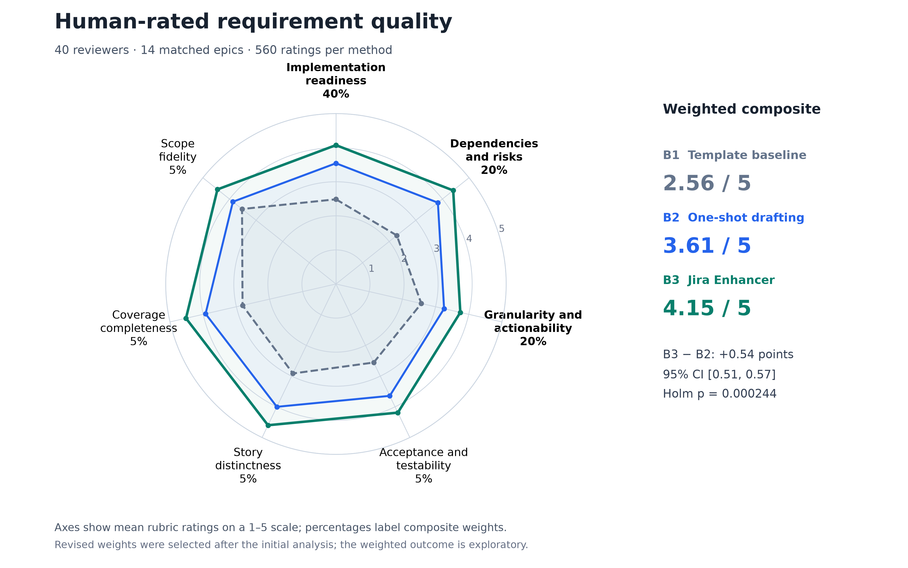

# Jira Enhancer replication package

Jira Enhancer turns incomplete Jira issues and epics into reviewable developer stories. It gathers linked evidence, refines drafts through reinforcement-learning-guided prompt-policy selection, and combines validation, explicit human approval, and source-bound writeback checks.

This repository accompanies **“Jira Enhancer: An Empirical Evaluation of Governed Epic-to-Story Decomposition.”** It contains the implementation, executable tests, analysis scripts, de-identified research inputs, aggregate reviewer results, and manuscript assets.

[Read the manuscript](patent/emse/jira_enhancer_emse.pdf) · [Reproduction guide](docs/REPRODUCIBILITY.md) · [Matched-review results](patent/reviewer_study/public_results/RESULTS.md)


## Start here

Use Python 3.11 or newer and run these commands from the repository root:

```bash
python3 -m venv .venv
source .venv/bin/activate
python -m pip install --upgrade pip
python -m pip install -e '.[reviewer]'
make reviewer-check
```

`make reviewer-check` runs the application tests, verifies the released evidence, recalculates the matched-review results, repeats the seeded transaction experiment, and regenerates the current research figures. The weighted-score verifier prints the means, paired differences, confidence intervals, and exact and Holm-adjusted p-values from the released epic-level scores.

## Package contents

| Location | Contents |
|---|---|
| [`src/jira_enhancer/`](src/jira_enhancer/) | Application, synthetic demonstration fixtures, connectors, scoring, prompt selection, approval, and writeback controls |
| [`tests/`](tests/) | Unit, workflow, prompt-policy, and transaction tests |
| [`openapi/`](openapi/) | API and event contracts |
| [`patent/artifacts/evaluation/`](patent/artifacts/evaluation/) | De-identified field tables and formula-generated sensitivity inputs |
| [`patent/artifacts/b2_b3_pilot/`](patent/artifacts/b2_b3_pilot/) | Aggregate held-out diagnostic results and sanitized model-critic posterior trace |
| [`patent/reviewer_study/public_results/`](patent/reviewer_study/public_results/) | Matched-review aggregates, exact-test calculations, reliability summaries, resource counts, and radar plot |
| [`patent/generated/`](patent/generated/) and [`patent/images/`](patent/images/) | Research result tables, publication figures, and architecture diagrams |
| [`patent/emse/jira_enhancer_emse.tex`](patent/emse/jira_enhancer_emse.tex) | Current manuscript source, with the bibliography and compiled PDF alongside it |
| [`docs/REPRODUCIBILITY.md`](docs/REPRODUCIBILITY.md) | Input definitions, commands, seeds, outputs, and manuscript-build instructions |
| [`RELEASE_FILE_MANIFEST.json`](RELEASE_FILE_MANIFEST.json) | SHA-256 hashes of the distributed files |

## Matched human-review results

Forty reviewers assessed 42 packages containing 210 stories from 14 common epic inputs. Each reviewer supplied 42 primary ratings and four masked repeats. The analysis averages ratings within each epic and method, giving 14 paired inference units.

| Outcome | B2: one-shot drafting | B3: Jira Enhancer |
|---|---:|---:|
| Priority-weighted quality, 1–5 | 3.61 | 4.15 |
| Implementation readiness, 1–5 | 3.54 | 4.08 |
| Ready-or-Minor-revision ratings | 64.6% | 77.3% |
| Major-revision ratings, out of 560 per method | 198 | 127 |

The paired weighted-quality difference is **+0.54 points** (95% epic-bootstrap CI [0.51, 0.57], Holm-adjusted exact p = 0.000244), with B3 higher on all 14 epics. Mean recorded assessment time was **2.17 minutes lower** for B3 (95% CI [−2.39, −1.98], Holm-adjusted exact p = 0.000244).

The composite assigns implementation readiness 40%, dependencies and risks 20%, granularity and actionability 20%, and each of scope fidelity, coverage completeness, story distinctness, and acceptance/testability 5%. The weights were selected after the initial analysis and define an exploratory weighted outcome using the corrected reviewer ratings. The comparison covers the complete workflows: B2 used 14 model calls and B3 used 173.



The [results summary](patent/reviewer_study/public_results/RESULTS.md), [Holm calculation](patent/reviewer_study/public_results/HOLM_RECALCULATION.md), and [paired epic means](patent/reviewer_study/public_results/matched_review_epic_scores.csv) provide the calculation details and public inputs.

## Reproduction commands

| Command | Result |
|---|---|
| `make test` | Runs the Python application and workflow tests |
| `make mock-demo` | Processes the bundled `DEMO-18324` issue with deterministic local reasoning |
| `make public-artifact` | Checks released hashes, schemas, row counts, and field-summary statistics |
| `make fault-injection` | Runs 72,000 seeded observations across four transaction-control arrangements |
| `make public-figures` | Rebuilds the refinement-effort, matched-review radar, arm-learning, and critic-reward figures |
| `make matched-review` | Recalculates the weighted matched-review contrasts from 42 public aggregate rows |
| `python patent/reviewer_study/plot_weighted_review_radar.py` | Rebuilds the radar plot from the released seven-dimension summaries |
| `make paper` | Compiles the manuscript using `latexmk` |

The field tables contain 70 terminal Jira outcomes across two deployment waves: 69 created issues and one linked existing issue. The latest-wave audit covers 45 parent links and 44 newly created payloads. The transaction experiment uses nine fault scenarios, 2,000 trials per scenario, and four control arrangements; A3 recorded zero unsafe mutations in its 18,000 observations and permitted all eligible writes.

The scoring diagnostics apply deterministic formulas to 5,000 generated units and to public issue descriptions. The held-out diagnostic provides aggregate model assessments for three packets and a sanitized trace of 99 critic observations used for prompt-arm posterior updates. These input types and their corresponding outputs are described in the [reproduction guide](docs/REPRODUCIBILITY.md).

## Run the local console

The bundled demonstration uses synthetic Jira, Confluence, and Bitbucket fixtures:

```bash
export CODEX_CONFIG_PATH="$(pwd)/outputs/reproduced/no-codex-config.toml"
export JIRA_ENHANCER_CONNECTOR_MODE=mock
export JIRA_ENHANCER_REASONING_MODE=heuristic
export JIRA_ENHANCER_USE_CODEX_EXEC=false
export JIRA_ENHANCER_RL_ENABLED=false

PYTHONPATH=src python -m jira_enhancer \
  --storage-root ./outputs/reproduced/mock-runtime \
  serve --host 127.0.0.1 --port 8080
```

Open <http://127.0.0.1:8080/> to create a run, inspect generated candidates, record a review decision, and execute approved mock writeback. The demonstration creates its local output store on execution. The [API contracts](openapi/) describe the run, review, and writeback interfaces.

## Public issue-text diagnostic

To download the SWE-bench Lite test split and apply the declared scoring formulas:

```bash
make install-benchmark
make public-benchmark
```

This diagnostic reports scoring-model sensitivity across public issue texts. Its tables and figures are written under `patent/generated/`.

## Downstream development and testing work log

The [sanitized rebalancing work log](patent/artifacts/stomp-rebalance-work-log-20261103/README.md) records the 2 November 2026 implementation and testing iteration: 1,083 retained event positions, including 754 command records. It preserves successful and failed outcomes, recorded user interventions, and five selected execution windows with no additional input after the initiating request or approval.

The [redaction record](patent/artifacts/stomp-rebalance-work-log-20261103/REDACTION_LOG.json) explains the omitted commands, console text, identifiers and confidential operational details. Source hashes and an export script support inspection against the restricted original folder. This is a sanitized audit extract, not a raw-console archive or evidence of an entirely unattended project. The November iteration is distinct from the October scale-out validation.

## Manuscript and citation

The current [63-page manuscript](patent/emse/jira_enhancer_emse.pdf) is accompanied by its LaTeX source, bibliography, tables, and figures in `patent/emse/`. Install a TeX distribution with `latexmk`, then run `make paper`; the rebuilt PDF is written to `patent/emse/.build/jira_enhancer_emse.pdf`.

> Manish Kumar Agrawal, Sandeep Kumar, Ashok Shukla, Subham Kumar, Abhishek Gupta, and Nandagopal Srinivasan. 2026. *Jira Enhancer: An Empirical Evaluation of Governed Epic-to-Story Decomposition.* Research article. Manuscript materials and the replication artifact are available in this repository.

The code and research artifact are supplied for scholarly review and reproducibility inspection under author-retained rights. Contact the authors for redistribution or reuse permissions.
